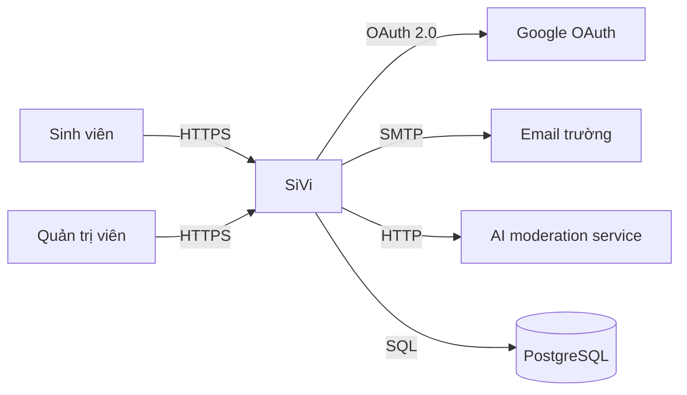
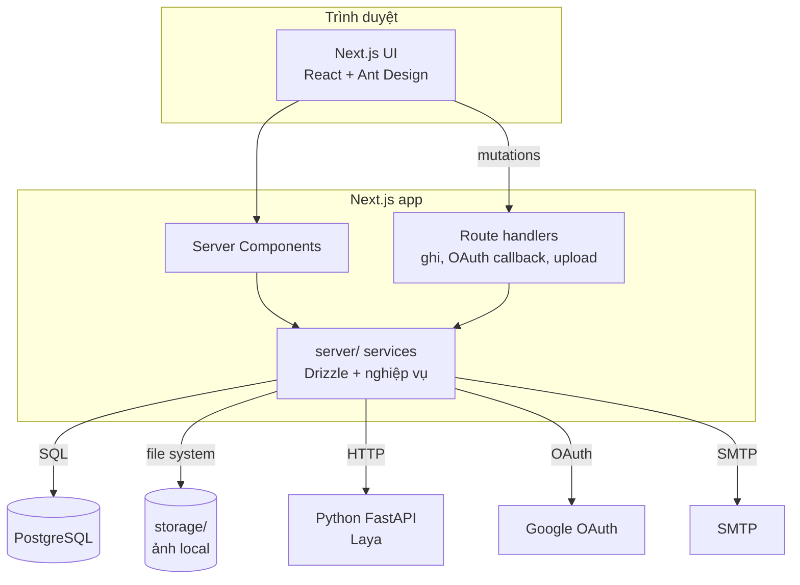
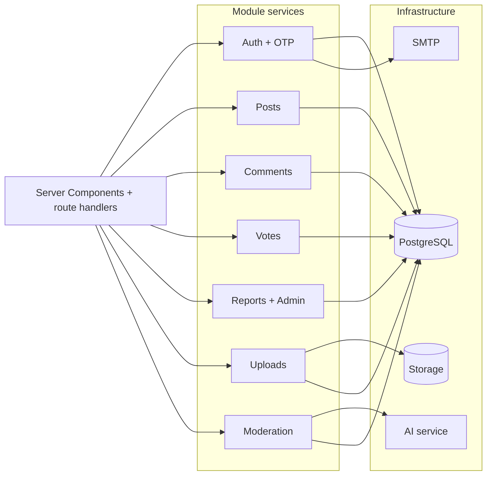
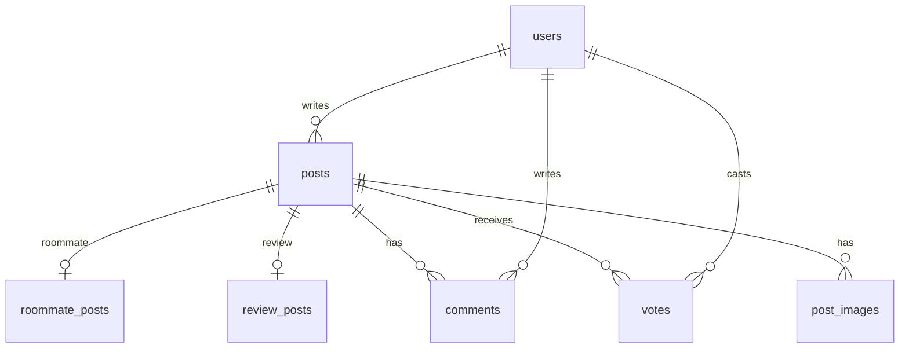
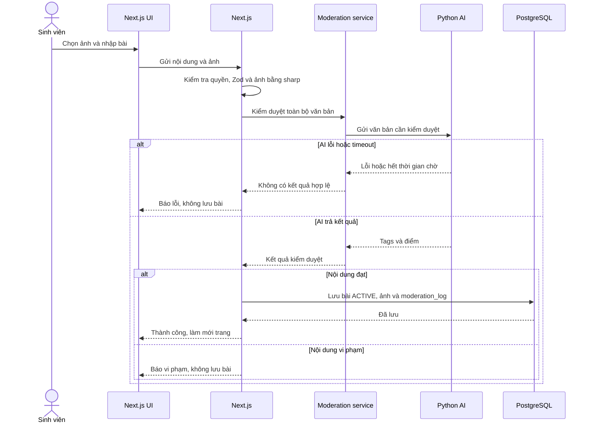
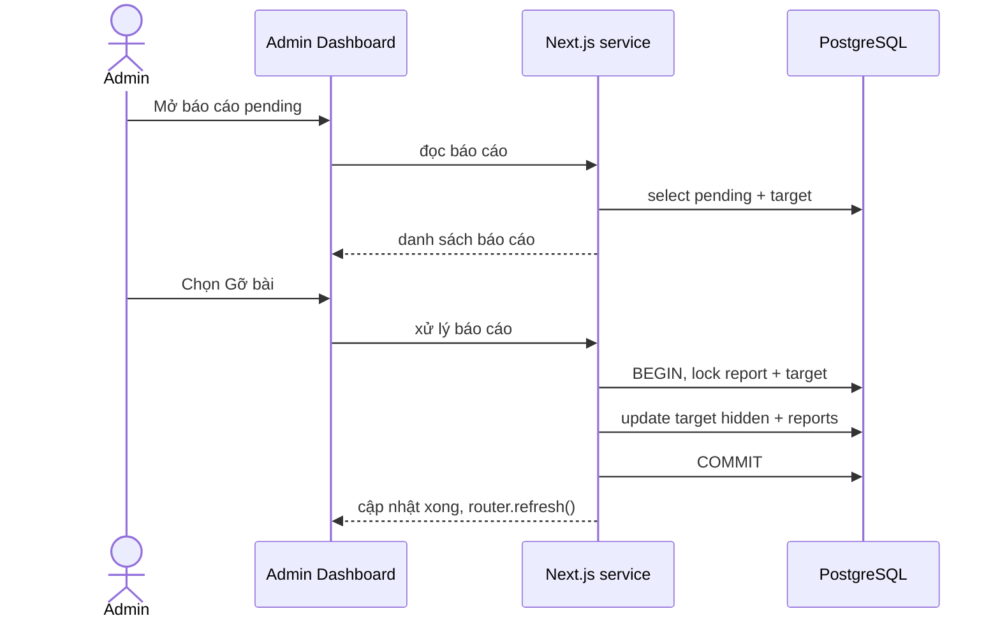
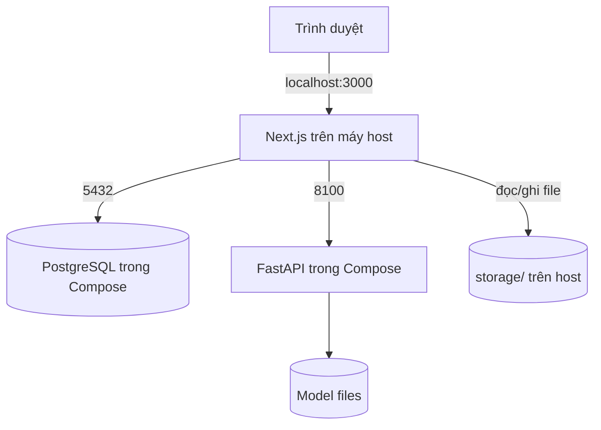
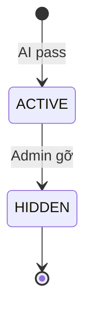

# Bộ architecture diagram dễ đọc cho SiVi

**Mục tiêu:** chọn ít diagram nhưng mỗi cái trả lời đúng một câu hỏi, dễ review trong PR và dễ trình bày với giảng viên.

## 1. Bộ diagram

| Ưu tiên | Diagram                           | Trả lời câu hỏi                            | Đối tượng              |
| --------: | --------------------------------- | ---------------------------------------------- | -------------------------- |
|         1 | System Context                    | Ai dùng, hệ thống nối với dịch vụ nào? | Giảng viên, người mới |
|         2 | Container                         | Có những runtime/container nào?             | Cả nhóm                  |
|         3 | Component                         | Bên trong Next.js có module gì?             | Dev                        |
|         4 | ERD core                          | Dữ liệu chính liên kết thế nào?         | Dev, DB                    |
|         5 | Sequence: đăng bài + AI        | Một bài đi qua những bước nào?          | Dev, QA                    |
|         6 | Sequence: admin xử lý báo cáo | Gỡ bài/bình luận diễn ra thế nào?       | Dev, Admin                 |
|         7 | Deployment                        | Chạy ở đâu, container nào?                | Infra, báo cáo           |
|         8 | State: bài đăng                | Trạng thái bài thay đổi ra sao?           | Dev, QA                    |

Không nên vẽ một ERD 20 bảng thật to rồi cố nhồi mọi thứ vào. Hãy tách:

- ERD lõi forum: users, posts, roommate_posts, review_posts, comments, votes.
- ERD auth/trường: universities, university_domains, users, verification_requests, sessions.
- ERD kiểm duyệt/báo cáo: reports, moderation_logs.

## 2. System Context

Dùng khi giới thiệu tổng quan, không đi vào công nghệ.

**Cách đọc:** người dùng đi vào SiVi; SiVi phụ thuộc Google, email, AI và database.

## 3. Container

Đây là diagram quan trọng nhất, dùng làm “một trang kiến trúc”.

**Cách đọc:** trang đọc qua Server Components và service; route handlers chỉ phục vụ ghi, OAuth, upload.

## 4. Component trong Next.js

Dùng khi chia việc hoặc review code.

**Cách đọc:** controller chỉ điều phối; service chứa nghiệp vụ; infra là DB, storage, AI, mail.

## 5. ERD lõi forum

Chỉ vẽ phần lõi trước; các bảng auth để diagram riêng.

**Cách đọc:** một user viết nhiều bài; mỗi bài là roommate hoặc review; bài có comment, vote và ảnh.

## 6. Sequence: đăng bài kèm AI

**Cách đọc:** ảnh đi cùng thao tác tạo bài; chỉ nội dung được chấp nhận mới tạo bài; lỗi AI thì fail closed.

## 7. Sequence: admin xử lý báo cáo

**Cách đọc:** một quyết định áp dụng cho toàn bộ báo cáo của cùng nội dung, không chỉ báo cáo đang chọn.

## 8. Deployment

**Cách đọc:** Compose chỉ chạy PostgreSQL và AI; Next.js chạy trực tiếp trên máy phát triển.

## 9. State: bài đăng

## 10. Công cụ

| Mục đích                | Công cụ                 | Lý do                                                |
| -------------------------- | ------------------------- | ----------------------------------------------------- |
| Lưu trong repo, review PR | Mermaid                   | Render trực tiếp trên GitHub, sửa bằng text      |
| ERD chi tiết              | DBML + dbdiagram.io       | Dễ đọc, export PNG/SVG                             |
| Báo cáo đẹp            | draw.io / diagrams.net    | Chỉnh layout, màu, export                           |
| Thảo luận nhanh          | Excalidraw                | Vẽ tay, không cần chuẩn                           |
| C4 chuyên sâu            | Structurizr / C4-PlantUML | Khi cần nhiều level; hơi nặng cho nhóm 5 người |

## 11. Nguyên tắc để diagram dễ đọc

1. Mỗi diagram chỉ trả lời một câu hỏi.
2. Tối đa 7–9 box chính; chi tiết đẩy xuống diagram khác.
3. Ghi rõ protocol khi cần.
4. Dùng cùng một tên cho module trong code và diagram.
5. Đừng trộn deployment với business flow.
6. ERD lớn phải tách theo domain.
7. Màu chỉ để phân nhóm, không dùng quá 3 màu.
8. Diagram trong repo dùng Mermaid/DBML; PNG chỉ để xuất báo cáo.

## 12. Bộ tối thiểu để trao đổi

Nếu chỉ có 30 phút để trình bày, dùng 4 cái:

1. Container.
2. ERD lõi forum.
3. Sequence đăng bài + AI.
4. Sequence admin xử lý báo cáo.

Context dùng để mở đầu; Component và Deployment để trả lời câu hỏi kỹ thuật.
